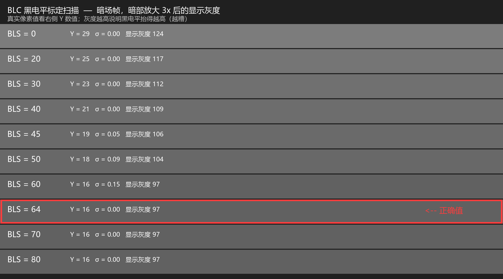
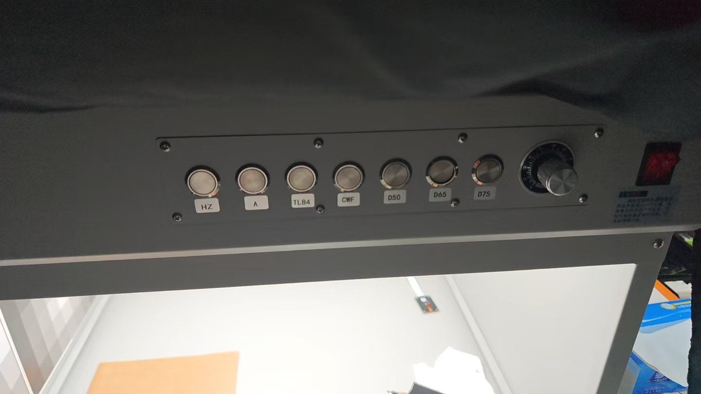
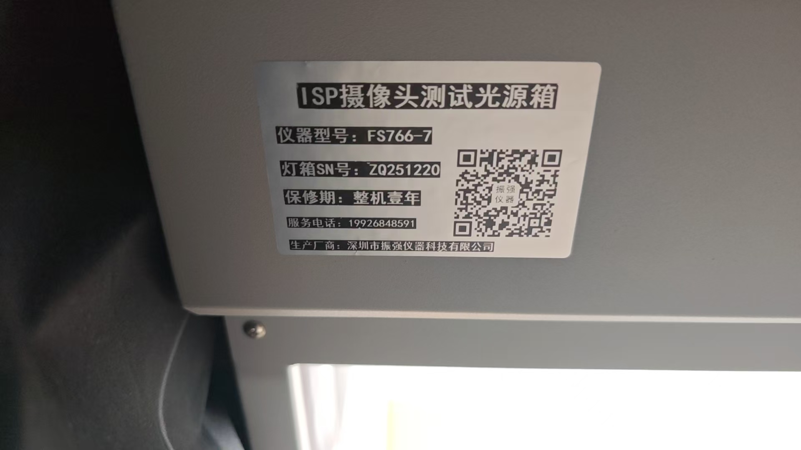
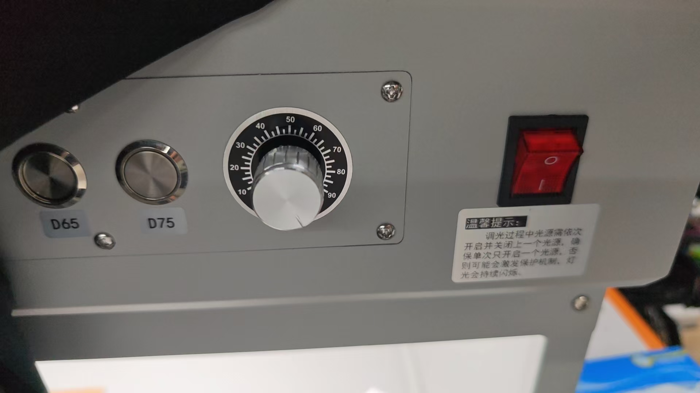
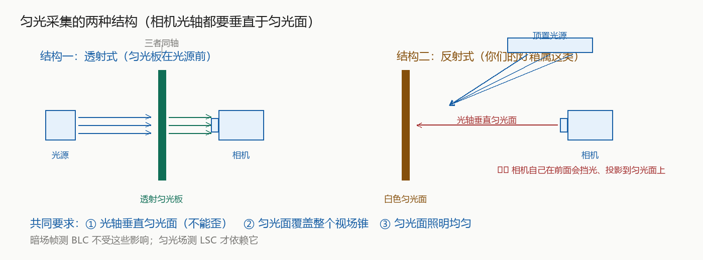
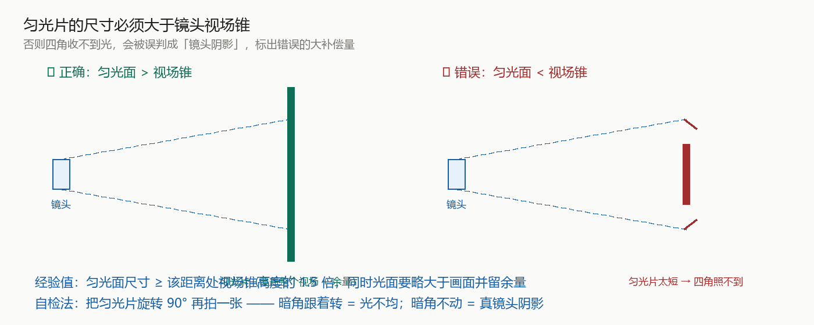

# OV13855 ISP 调试

内核版本 Linux 6.12　|　板卡 myd-js8mpq　|　ISP 输出节点 `/dev/video2`

---

## 0. 环境准备

### 0.1 vvext 做成全局命令

`vvext` 原本在 `/opt/imx8-isp/bin/`，不在 PATH 里。做个软链接后**任意目录直接调用**，
不需要 `cd`、不需要 `./`、也不需要设 `LD_LIBRARY_PATH`：

```sh
ln -sf /opt/imx8-isp/bin/vvext /usr/bin/vvext
```

用法：

```sh
vvext <video_id> "窗口名" "参数"      # 直接命令
vvext <video_id>                      # 交互式菜单
```

`<video_id>` 对应 `/dev/video<N>` 的 N。**ISP 输出节点是 /dev/video2，所以用 `vvext 2`。**

> ⚠️ `vvext -h` 会报 `wrong videoid data type` —— 它不认 `-h`，必须带数字参数。

### 0.2 推流（在 PC 上用 VLC 看画面）

板端板卡 IP 会变，用前先确认。PC 端 VLC 打开：

```
udp://@:5600
```

板端起流（1920x1080 @ 12Mbps，H.264 硬编，MPEG-TS over UDP）：

```sh
gst-launch-1.0 -e \
  v4l2src device=/dev/video2 ! \
  video/x-raw,format=YUY2,width=1920,height=1080 ! \
  vpuenc_h264 bitrate=12000 gop-size=30 ! \
  h264parse config-interval=1 ! \
  mpegtsmux ! tee name=t \
  t. ! queue max-size-buffers=8 leaky=downstream ! \
       udpsink host=<PC_IP> port=5600 sync=false async=false buffer-size=2097152 \
  t. ! queue max-size-buffers=8 leaky=downstream ! \
       udpsink host=<PC_IP> port=5601 sync=false async=false buffer-size=2097152
```

- `5600` 给 VLC 看，`5601` 是复制出来的监控口（用于码流质量分析，**别用 VLC 占它**）
- **PC 的 UDP 5000 端口常被系统占用**，所以用 5600
- 用 `tee` 是因为**编码和封装只做一次**，两路 udpsink 共用
- PC 侧 VLC 建议加 `--network-caching=350`，否则会周期性卡顿
  （H.264 正常码率波动 ±50%，缓存只有 100ms 存不下）

或者直接用封装好的脚本：

```sh
isp_stream.sh start 1920x1080 12000    # 起流
isp_stream.sh stop                     # 停
isp_stream.sh restart                  # 重启
isp_stream.sh status                   # 看状态
```

### 0.3 抓帧

**⚠️ 定量标定只能用 `CAPTURE`，不能用 PNG 路径。** 原因见下。

#### 方式 A：`vvext CAPTURE`（首选 —— 不停流、零转换）

```sh
vvext 2 "CAPTURE" 0
```

| 特性     | 说明                                                                     |
| -------- | ------------------------------------------------------------------------ |
| 前提     | **需要 /dev/video2 上有活跃数据流**，否则报 `Capture ... failed` |
| 是否停流 | **不停流** → **不会重置 ISP 设置**，调好的参数一直有效      |
| 输出     | 原始 **YUV422I**，**零转换**                                 |
| 路径     | **`/opt/imx8-isp/bin/`**（isp_media_server 的工作目录）          |
| 命名     | `Image_<宽>_<高>_YUV422I_<日期><id>.yuv`                               |
| 大小     | 宽 × 高 × 2（实测精确吻合）                                            |

拉回 PC 分析：

```bash
scp root@<板卡IP>:/opt/imx8-isp/bin/Image_*.yuv .
python isp_analyze.py --raw 1920x1080 stats Image_1920_1080_YUV422I_*.yuv
```

#### 方式 B：gst-launch（会占用设备，需先停流）

```sh
# 原始 YUY2（无损）
gst-launch-1.0 -e v4l2src device=/dev/video2 num-buffers=1 ! \
  video/x-raw,format=YUY2,width=2112,height=1568 ! filesink location=/tmp/frame.yuv

# PNG（只用来肉眼看，不要用于定量！）
gst-launch-1.0 -e v4l2src device=/dev/video2 num-buffers=3 ! \
  video/x-raw,format=YUY2,width=1920,height=1080 ! \
  videoconvert ! pngenc ! multifilesink location=/tmp/frame_%03d.png
```

封装的脚本命令：

```sh
isp_stream.sh cap 2        # 用 vvext CAPTURE 抓 2 张原始 YUV（不停流）
isp_stream.sh grab 3       # 抓 3 张 PNG（会停流）
```

#### 为什么不能用 PNG 路径做定量

同一次遮光条件下，两种路径的结果对比：

| 抓帧方式          | Y  | Cb              | Cr              |
| ----------------- | -- | --------------- | --------------- |
| gst + PNG         | 49 | 130.6           | **139.6** |
| **CAPTURE** | 26 | **128.0** | **128.0** |

PNG 路径经过了 `videoconvert → RGB → PNG → 再转回 YCbCr` 的往返，**引入了色彩误差**。
CAPTURE 是零转换，Cb/Cr 精确 128/128、σ=0.00 —— 那才是真实的中性灰。

#### 用 YUView 预览 CAPTURE 出来的 YUV

`CAPTURE` 输出的是 **packed（交织）YUYV**，字节排布是 `Y0 U Y1 V`，2 字节/像素：

```
BLS=0 那张的前 16 字节:  29 128 29 128 29 128 29 128 ...
                         Y   U   Y   V   Y   U   Y   V
```

**⚠️ YUView 内置格式列表里没有 packed YUYV**（只有 planar 的 4:2:0 / 4:2:2 / 4:4:4 和 V210）。
直接选 `YUV 4:2:2 8-bit` 会得到**竖条纹 + 偏绿**，原因：

| 按 planar 强行解读    | 算出                   | 屏幕上             |
| --------------------- | ---------------------- | ------------------ |
| Y 平面 = 前 W×H 字节 | 偶数列 29 / 奇数列 128 | **竖条纹**   |
| U 平面                | 78.5（应为 128）       | 缺蓝 → 偏黄       |
| V 平面                | 78.5（应为 128）       | 缺红 → 偏青       |
|                       |                        | **合成呈绿** |

（packed YUYV 和 planar I422 的字节数**恰好相同**都是 W×H×2，所以 YUView 不报错，只是解错。）

**正确做法：用 `Custom...` 建一个 packed 格式**

在 `YUV Format` 下拉里选 **`Custom...`**，弹出 *Custom YUV Format* 对话框，按下表填：

| 字段                         | 值                                           |
| ---------------------------- | -------------------------------------------- |
| **Chroma Subsampling** | **`422`** ← 不是 420！YUYV 是 4:2:2 |
| Bit depth                    | `8`                                        |
| Endianness                   | `Little Endian`                            |
| Chroma Offset X / Y          | `0` / `0`                                |
| **Planar**             | **取消勾选**                           |
| **Packed**             | **勾选**                               |
| **Packing order**      | **`YUYV`**                           |
| Byte packing                 | 不勾（8 位每分量 1 字节）                    |

填完点 OK，再去 `Raw File Properties` 里填 **Width 1920 / Height 1080**。

**验证**：打开后应该是**一整块均匀的灰色**。

- 均匀灰 ✅ 对
- 竖条纹 + 偏绿 ❌ Planar 没取消 / Packing order 选错
- 有画面但颜色怪 ❌ Chroma Subsampling 还是 420

配置一次之后可以一直用，**CAPTURE 出来的文件直接看，不需要再转 I420**。

> 备选方案（如果 Custom 配不好）：转成 planar I420 再看
>
> ```sh
> gst-launch-1.0 -e filesrc location=A.yuv ! \
>   rawvideoparse format=yuy2 width=1920 height=1080 ! \
>   videoconvert ! video/x-raw,format=I420 ! filesink location=A_i420.yuv
> ```
>
> 然后 YUView 用 `YUV 4:2:0 8-bit`。**认文件的诀窍：I420 是 W×H×1.5 = 3,110,400 字节，
> packed YUYV 是 W×H×2 = 4,147,200 字节。**

> **暗场帧是均匀纯色，YUView 看不出 BLS 好坏。** 要快速对比，用暗部放大后的 PNG
> （见下方 BLC 一节）；要精确读数，用 `isp_analyze.py`。

#### ⚠️ 三个重要前提

1. **RAW 拿不到。** `/dev/video2` 虽然广告了 `BG10`(10-bit Bayer)，但

   - GStreamer 侧 4 种写法（`bggr10le`/`gbrg10le`/`grbg10le`/`rggb10le`）全部 `could not link`
   - `v4l2-ctl --set-fmt-video=...,pixelformat=BG10` 返回 0 但**静默回退到 YUYV**
     → **ISP 在 mode 0 下不产生 RAW 输出**，BLC 只能用间接法测。
2. **ISP 输出是 limited range（16~235）。** Y 的下限被钳位在 **16**，
   所以 Y 到 16 就意味着"已到黑位"，再减只会钳位而不改变读数。
3. **起流会重置 ISP 运行时设置。** 每次 `isp_stream.sh start/restart` 之后，
   之前用 `vvext` 设的参数都会丢，**必须重新执行一遍**。

---

## 1. BLC 黑电平

### 关闭其他参数

`BLC` 是整条链的第一步。测量前必须**关掉所有会把黑点整体移位的后级模块**，
否则测出来的不是黑电平。

同时**必须固定增益** —— 暗电流基底会被 PGA 放大，黑电平随增益升高而升高。
而**遮住镜头后 AEC 会认为"太暗"而把增益/曝光拉到最大**，那时测到的值毫无意义。

```sh
vvext 2 "AEC On/Off" 0
vvext 2 "AEC Gain" 1.0
vvext 2 "CPROC ON/OFF" 0
vvext 2 "GAMMA ON/OFF" 0
vvext 2 "AWB On/Off" 0
vvext 2 "CCM INPUT" "1,0,0,0,1,0,0,0,1"
vvext 2 "GAIN INPUT" "1, 1, 1, 1"
```

各条的作用：

| 命令                    | 为什么必须关                           |
| ----------------------- | -------------------------------------- |
| `AEC On/Off 0`        | 锁定增益，否则黑电平随增益浮动         |
| `AEC Gain 1.0`        | 固定到一个有代表性的增益档             |
| `CPROC ON/OFF 0`      | CPROC 的 brightness 会把黑点整体抬高   |
| `GAMMA ON/OFF 0`      | gamma 非线性，会拉伸暗部，读数不可用   |
| `AWB On/Off 0`        | 排除白平衡对色度的干扰                 |
| `CCM INPUT` 单位阵    | 单位矩阵 = 不做色彩校正，排除 CCM 干扰 |
| `GAIN INPUT` 单位增益 | 手动增益设为 1x                        |

> 注意：`GAIN INPUT` 和 `CCM INPUT` **只在 AWB 关闭时才生效**（手册明确说明）。

### 采集与求解

遮住镜头（镜头盖 / 黑布，**必须完全无光**），等 3~5 秒让管线稳定，然后调整BLS（黑电平削减）：

```sh
vvext 2 "BLS" "0, 0, 0, 0"          # 设置完后抓帧A
vvext 2 "CAPTURE" 0

vvext 2 "BLS" "200, 200, 200, 200"  # 设置完后抓帧B
vvext 2 "CAPTURE" 0
```

把两张帧拉到 PC，用两点法线性求解：

```bash
python isp_analyze.py --raw 1920x1080 blc --bls 0 --bls 200 A.yuv B.yuv
```

> ⚠️ 参数顺序有讲究：`--bls` 是 append 类型、`frames` 是可变位置参数，
> **必须把 `--bls` 全部写在文件路径之前**，否则报 `unrecognized arguments`。

### 实测结果

在 1920×1080、遮光、前置全关（AEC/CPROC/GAMMA 关、AWB 关 + 单位 CCM + 单位增益）、
增益 1.0 的条件下，用 `CAPTURE` 扫描：

| BLS                        | Y_min          | Y_mean         | σ             | 说明                                 |
| -------------------------- | -------------- | -------------- | -------------- | ------------------------------------ |
| 0                          | 29             | 29.0           | 0.00           | 未削减，黑电平浮着                   |
| **16**（XML 里的值） | **≈26** | —             | —             | 黑位抬高 10 级 → **暗部发灰** |
| 20                         | 25             | 25.0           | 0.00           |                                      |
| 30                         | 23             | 23.0           | 0.00           |                                      |
| 40                         | 21             | 21.0           | 0.00           |                                      |
| 45                         | 19             | 20.0           | 0.05           |                                      |
| 50                         | 18             | 19.0           | 0.09           |                                      |
| 60                         | 16             | 16.0           | **0.15** | 快到黑位，但仍有残余起伏             |
| **64**               | **16**   | **16.0** | **0.00** | ✅ **恰好完全抵消**            |
| 70                         | 16             | 16.0           | 0.00           | 已过头（会开始削暗部真实信号）       |
| 80                         | 16             | 16.0           | 0.00           | 同上                                 |
| 200                        | 16             | 16.0           | —             | 钳位，无变化                         |

**规律**：斜率 ≈ **0.2 Y / BLS**（即 **1 个输出灰阶 = 5 个 BLS 单位**），线性度良好。
`U/V` 全程恒为 128 → 色彩链路干净，前置设置生效。

**σ 是第二条独立证据**：BLS=60 时 σ=0.15（基底残留 4 个单位，还有起伏），
到 **BLS=64 时 σ 归零**（完全抵消），再往上也是 0（但因为钳位，已无区分力）。
所以 **64 就是那个恰好抵消基底的点**。

### 扫描对比图

各采样点的暗场帧，**暗部放大 3x** 后的显示灰度。灰色越亮 = 黑电平抬得越高 = 越糟：



能明显看出：`BLS=0` 是最亮的灰（黑位浮着），随 BLS 增大逐渐变暗，
到 `BLS=64` 到达最暗并封顶（正确值）。

**素材文件**（都在 `picture/BLC标定/`）：

| 文件                          | 说明                                                       |
| ----------------------------- | ---------------------------------------------------------- |
| `BLC扫描对比条带.png`       | 上面那张对比图                                             |
| `BLS<n>_暗部放大3x.png`     | 每个采样点的暗部放大图（n = 0/20/30/40/45/50/60/64/70/80） |
| `BLS<n>_1920x1080_YUYV.yuv` | 原始帧（packed YUYV，可用 YUView 打开复核）                |

> 放大用的是 `gst-launch` 的 `gamma gamma=3.0` —— 把暗部拉开，让肉眼能分辨
> 16 和 29 这种只差 13 级的差别（原样看两张都是黑的）。
> 转换命令：
>
> ```sh
> gst-launch-1.0 -e filesrc location=A.yuv ! \
>   rawvideoparse format=yuy2 width=1920 height=1080 ! \
>   videoconvert ! gamma gamma=3.0 ! videoconvert ! pngenc ! filesink location=A_x3.png
> ```

### 结论

```sh
vvext 2 "BLS" "64, 64, 64, 64"
```

**✅ 已改入 XML 并验证**（2026-09-29）：

| 文件                                    | 改动                                                          |
| --------------------------------------- | ------------------------------------------------------------- |
| `OV13855_13M_10_2112x1568_linear.xml` | 第 433 行 `<blsData>`、第 609~612 行 `<bls>` 块：16 → 64 |
| `OV13855_13M_10_4096x3072_linear.xml` | 同上                                                          |
| `OV13855_13M_10_4224x3136_linear.xml` | 同上                                                          |

**验证结果**：`PRELOAD` 热重载 + 重启推流后抓暗场帧 →
`Y_min=16  Y_mean=16.0  σ=0.00  U/V=128` ✅
**不需要再手工跑任何 vvext 命令**，XML 里就是对的。

**XML 改动点**（`2112x1568` / `4096x3072` / `4224x3136` 三个文件相同）：

改动前：

```xml
<blsData index="1" type="double" size="[1 4]">[16 16 16 16]</blsData>
```

```xml
<bls bypass="true">
    <red>16</red>
    <green.b>16</green.b>
    <green.r>16</green.r>
    <blue>16</blue>
</bls>
```

改动后：

```xml
<blsData index="1" type="double" size="[1 4]">[64 64 64 64]</blsData>
```

```xml
<bls bypass="true">
    <red>64</red>
    <green.b>64</green.b>
    <green.r>64</green.r>
    <blue>64</blue>
</bls>
```

回滚：把上面两处 `64` 改回 `16`，再执行 `vvext 2 "PRELOAD" 1`。

> ⚠️ **改 XML 的 sed 有个坑**：捕获组 `\([^>]*>\)` 把 `>` 包进去了，
> 再在替换串里补 `>` 会**多输出一个 `>`**，导致 `<blsData ...]">>[64 ...]` 这种**语法错误**。
> 正确写法是替换串里**不要再补 `>`**：
>
> ```sh
> sed -i "s|<blsData\([^>]*>\)\[16 16 16 16\]|<blsData\1[64 64 64 64]|" file.xml
> ```
>
> **改完务必用 `diff` 对比备份，并用 XML 解析器校验语法。**

**取 64 有两个独立印证：**

1. **等于 OV13855 的 RAW10 黑电平基底**。OV 系列传感器黑电平标准值是 **64（0x40）**，
   而 BLS 用的正是传感器原始域的单位 —— "减 64" 恰好抵消"基底 64"。
2. **等于 NXP OS08A20 参考文件里的原值**。
   这份 XML 是从 OS08A20 抄来的，**唯一被改动的数字就是 `blsData` 从 64 改成 16**。
   → **这个值本来就是对的，是被改坏的。**

**16 与 64 的差别**：

```
BLS=16  →  Y ≈ 26   （黑位抬升 10 级，约占满量程 4%）
BLS=64  →  Y = 16   （正落黑位）
```

10/255 ≈ 4% 的暗部抬升就是**画面发灰、黑色不黑、对比度差**的直接来源。
数值不大，但黑位这种东西差 10 级肉眼可辨。

验证并写回持久化：

```sh
vvext 2 "PRELOAD" 1        # 改完 XML 后热重载标定文件，不用重启 ISP
```

**要改的 XML 文件（三个都要改）**：

```
/opt/imx8-isp/bin/OV13855_13M_10_2112x1568_linear.xml
/opt/imx8-isp/bin/OV13855_13M_10_4096x3072_linear.xml
/opt/imx8-isp/bin/OV13855_13M_10_4224x3136_linear.xml
```

每个文件里要改**两处**：

```xml
<blsData index="1" type="double" size="[1 4]">[16 16 16 16]</blsData>   →  [64 64 64 64]

<tuning>
  <bls bypass="true">
    <red>16</red> <green.b>16</green.b> <green.r>16</green.r> <blue>16</blue>   →  64
  </bls>
</tuning>
```

### 关于"多增益档"

手册要求 BLC 在**多个增益档分别采集**（1x/2x/4x/8x/16x），因为暗电流随增益变化。

但 **i.MX8MP 的 `BLS` 只有一组值**（`IF_BLS` 没有增益维度，XML 里也是单值），
跟 RK3576 那种"按增益建表"不同。所以做法要改成：

**在几个增益档各测一次，然后取一个折中值**（或在你最常用的工作增益档上测）。

本次测量固定在增益 1.0。

---

## 2. LSC 镜头阴影（⏸ 挂起 —— 手工逆向不可行，需要 NXP tuning tool）

> **当前状态**：LSC **保持关闭**。匀光场已采好、衰减已量化、表也算出来了，
> 但**写进 XML 后校正的空间分布不对**，根因是 ISP 的网格映射语义未公开。
> **在拿到 NXP 的 ISP tuning tool（或模组厂标定数据）之前，不要打开 LSC。**

### 2.1 设备

| 器材       | 型号 / 说明                                                                                  |
| ---------- | -------------------------------------------------------------------------------------------- |
| 标准光源箱 | **FS766-7**（深圳市振强仪器），**7 光源**：HZ / A / TL84 / CWF / D50 / D65 / D75 |
| 匀光片     | **透光型**（乳白亚克力／PC 扩散板）                                                    |
| 待标模组   | OV13855（MYIR MYD-JS8MPQ 开发板）                                                            |

**7 光源正好覆盖 XML 里的 5 个 LSC profile：**

| XML profile      | 灯箱光源     |
| ---------------- | ------------ |
| `A`            | A            |
| `D50`          | D50          |
| `D65`          | D65          |
| `F2`（=CWF）   | CWF          |
| `F11`（=TL84） | TL84         |
| —               | HZ、D75 富余 |







> ⚠️ **灯箱面板的警告**：调光过程中光源需**依次开启并关闭上一个光源**，确保单次只开一个，
> 否则会触发保护机制、光源持续闪烁。
> ⚠️ 旋钮是**亮度调节**（标度 10~90），可转过标度外；建议在 30~90 内使用，不要用到极限。
> ⚠️ **预热 10~15 分钟**再采集（灯源未稳定时实测比值会漂 4~5%）。

### 2.2 匀光的两种结构



- **透射式**：光源 → 混光腔 → **透光匀光板** → 相机（三者同轴，板夹在中间）
  → 背光 + 混光腔天然均匀，**最容易做对**
- **反射式**：光源照亮白色匀光面，相机正对该面（光源与相机**同侧**）
  → 本灯箱属这类；注意**相机自身会挡光、在匀光面上投影**

**共同要求**：① 光轴垂直匀光面 ② 匀光面覆盖整个视场锥 ③ 匀光面照明均匀

### 2.3 匀光片尺寸必须大于视场锥（最容易翻车的一点）



如果匀光面比视场锥小，画面四角根本收不到光 → 会被**误判成「镜头阴影」** → 标出错误的大补偿量。

**尺寸估算**：距离 `d` 处需要的匀光面对角线 = `2·d·tan(θ)`。
本镜头实测半对角视场 **≈41°**，所以：

| 相机到匀光面距离 | 需要的对角线 | 建议最小（留 1.5 倍余量） |
| ---------------- | ------------ | ------------------------- |
| 8 cm             | 14.1 cm      | 21 cm                     |
| 10 cm            | 17.6 cm      | 26 cm                     |
| 15 cm            | 26.4 cm      | 40 cm                     |

**自检法（决定「暗角」是真阴影还是光照不均）**：

| 方法                                     | 判据                                                         |
| ---------------------------------------- | ------------------------------------------------------------ |
| **改变距离**（镜头渐晕与物距无关） | 比值**变了** → 照明问题；**不变** → 真镜头阴影 |
| **平移相机**                       | 暗角跟着镜头走 = 镜头渐晕；留在原地 = 照明不均               |
| **旋转匀光面 90°**                | 暗角跟着转 = 板子/照明不均                                   |

### 2.4 采集步骤（必须切"线性状态"）

```sh
# 1) 关掉所有会影响亮度/色彩判读的模块（否则测的不是纯几何衰减）
vvext 2 "AWB On/Off" 0
vvext 2 "GAIN INPUT" "1, 1, 1, 1"
vvext 2 "CCM INPUT" "1,0,0,0,1,0,0,0,1"
vvext 2 "GAMMA ON/OFF" 0
vvext 2 "CPROC ON/OFF" 0

# 2) 固定曝光/增益（AE 会和灯箱调节抢控制权，必须先关）
vvext 2 "AEC On/Off" 0
vvext 2 "AEC ExposureTime" 0.01      # 10ms，50Hz 防闪烁值
vvext 2 "AEC Gain" 1.0               # 增益用 1.0，最干净

# 3) 抓帧（CAPTURE 不停流，零转换）
vvext 2 "CAPTURE" 0
```

**亮度要求**：线性化后的中心落在 **120~160**（太亮进压缩区、太暗量化精度不够）。

> ⚠️ **gamma 必须关** —— 实测同一匀光场：
> `gamma ON` 时角/中心 = **0.5684**，`gamma OFF` 时 = **0.4773**，
> **gamma 会把比值高估约 19%**，拿它算表会补偿不足。

> 💡 **亮度对结果不敏感**：在中心 77.6 和 140.6 两个不同亮度下，比值都是 0.32 左右 ——
> 因为 LSC 是**比值测量**，全局亮度会抵消。

### 2.5 匀光场实测：镜头衰减已量化

**实测（线性域，遮光条件）**：

| 检查项               | 结果                                     | 判断                                                     |
| -------------------- | ---------------------------------------- | -------------------------------------------------------- |
| 角/中心（线性域）    | **0.327**                          | 四角只有中心的 33%                                       |
| 等效 cos⁴ 角        | **≈41°**（全对角视场约 82°）    | —                                                       |
| 理论纯 cos⁴(36.8°) | 0.407                                    | 实测更暗 20% → **含机械渐晕**，对紧凑广角镜头正常 |
| 光心偏移             | Δx = **+26.5 px（1.38%）**        | 模组装配偏心，正常范围                                   |
| 上下对称             | 上边中 0.8061 / 下边中 0.8024            | ✅                                                       |
| 左右                 | 左边中 0.6698 / 右边中 0.6988（差 4.3%） | ✅ 与光心偏右一致                                        |

**径向衰减曲线**（归一化半径 → 相对中心）：

```
0.0~0.1  1.000    0.3~0.4  0.905    0.6~0.7  0.746    0.9~1.0  0.599
0.1~0.2  0.979    0.4~0.5  0.855    0.7~0.8  0.695
0.2~0.3  0.947    0.5~0.6  0.802    0.8~0.9  0.645
```

**三次独立互证（说明这个值是镜头固有属性）**：

| 次数 | 摆法                   | 角/中心          |
| ---- | ---------------------- | ---------------- |
| 1    | 竖直卡片（倾斜）       | 0.319            |
| 2    | 竖直卡片（ISP 重启后） | 0.3263           |
| 3    | 匀光片贴镜头           | **0.3271** |
| 4    | 匀光片贴镜头（重抓）   | **0.3271** |

后两次**完全相同**（且 md5 不同的新帧）→ **该衰减与匀光摆法无关，是镜头本身的渐晕**。

### 2.6 ⚠️ 手工逆向为什么失败 —— 已探明的 4 个硬约束

**约束 1：LSC 表的 `min` 必须恰好 = 1024**

| 表                   | min            | CAPTURE 结果                                |
| -------------------- | -------------- | ------------------------------------------- |
| 原始 OS08A20 表      | **1024** | ✅ 能抓                                     |
| 自己算的（min=1016） | 1016           | ❌ **failed**（ISP 挂掉，日志无提示） |
| 归一化到 min=1024    | **1024** | ✅ 能抓                                     |

**约束 2：`PRELOAD` 不能用来加载 LSC 表**

| 加载方式                            | 结果                                    |
| ----------------------------------- | --------------------------------------- |
| `vvext 2 "PRELOAD" 1`             | ❌ 之后开 LSC → ISP 挂，CAPTURE failed |
| **重启 `isp_media_server`** | ✅ 正常（XML 在启动时被读）             |

**约束 3：`LSC ON/OFF` 没有 XML 使能开关** —— 纯运行时控制，默认**关闭**。

**约束 4：ISP 的 LSC 网格是不等分的（等角度）**，且坐标系是输出帧的 **1920×1080**
（不是 sensor mode 的 2112×1568）。

```
D65 profile 的网格定义：
  LSC_sectors = 16     LSC_Xo / Yo = 15
  LSC_SECT_SIZE_X = [80 100 113 120 130 137 140 140]
  LSC_SECT_SIZE_Y = [59  63  65  68  69  72  73  71]
  → 每组 8 个值 ×2（镜像）求和 = 1920 / 1080  ✓
```

**失败记录**：

| 尝试                 | 结果                                                    |
| -------------------- | ------------------------------------------------------- |
| 按等分 17×17 采样   | ❌ 中心不该变却涨 1.63×，下角涨 3.1× 而上角只涨 1.6× |
| 按不等分网格边界采样 | ❌ 同样不对（中心仍涨 1.63×）                          |
| 映射探针（同会话）   | ⚠️ 用**跨会话**帧做比值，引入全局漂移，实验作废 |

> **教训**：LSC 的 A/B 对比**必须在同一次 ISP 会话内背靠背采集**，
> 且每帧都要记录曝光/增益寄存器作为凭证。

### 2.7 结论：为什么必须用官方工具

翻了 UG10168 全文，**LSC 只出现在 3 处**，且**完全没有**标定相关内容：

| 手册里有的                                                  | 手册里**没有**的                             |
| ----------------------------------------------------------- | -------------------------------------------------- |
| 3 个控制宏：`lsc.g.en` / `lsc.s.en` / `lsc.g. status` | ❌ 17×17 标定表怎么生成                           |
| `map.red/green.r/green.b/blue` 增益 [0..3.999]            | ❌ 网格怎么定义（sectors / No / Xo / Yo 的含义）   |
| `map.xsize` [10..1024] / `map.ysize` [8..1024] 块大小   | ❌ 表格数值的约定（Q10、min=1024、行列↔图像映射） |
| `LSC ON/OFF`（vvext 开关）                                | ❌ 17×17 与 16 sectors 的对应关系                 |
| `Figure 45. LSC ON vs. OFF`                               | ❌ 标定流程（怎么采、怎么算增益）                  |

> **LSC 表的格式约定与生成方法在 NXP 闭源的 IQ tuning tool 内部，手册刻意不公开。**
> **手工逆向不出来不是能力问题 —— 是文档层面就没有这部分信息。**

**三条出路（按推荐度）**：

1. **拿 NXP 官方 ISP tuning tool** —— LSC 网格/语义内置，不用逆向（最正规）
2. **找模组厂要 LSC 标定数据** —— 出厂就标好了
3. 继续逆向 —— 需要"同一会话内逐点探针"，工作量大，**不推荐**

### 2.8 别打开 LSC（打开更糟）

同会话 A/B 实测：

|                        | 中心  | 角/中心          |
| ---------------------- | ----- | ---------------- |
| **默认（关闭）** | 204.9 | **0.5622** |
| 明确 LSC ON            | 194.7 | **0.4354** |

XML 里那张表是 **OS08A20 的**，套在 OV13855 上 → **打开后四角反而更暗**。

**验收标准（将来实现了用）**：四角与中心亮度差 ≤ **5%**

```bash
python isp_analyze.py --raw 1920x1080 lsc 匀光场.yuv
```

### 2.9 已备好的素材与脚本

| 文件                                            | 说明                                                 |
| ----------------------------------------------- | ---------------------------------------------------- |
| `picture/LSC/D65_匀光场_贴镜头_1920x1080.yuv` | 匀光场原始帧（线性状态）                             |
| `picture/LSC/LSC表_亮度阴影_D65.txt`          | 算出来的 17×17 表（**校正位置不对，未采用**） |
| `picture/LSC/gen_lsc_table.py`                | 算表脚本（等分版）                                   |
| `gen_lsc_table_v2.py`                         | 算表脚本（按不等分网格边界版）                       |
| `patch_lsc_xml.py`                            | 把表写进 XML 的 D65 profile（第 3 组）               |
| `analyze_flatfield.py`                        | 匀光场分析（径向曲线 + 光心偏移 + 阴影分布图）       |
| `isp_analyze.py lsc`                          | 四角/中心亮度比 + 验收判定                           |

**XML 里要改的位置**（将来拿到正确数据时用）：

```
文件：OV13855_13M_10_2112x1568_linear.xml
  第 280~283 行 = D65 profile 的 4 个通道
  <LSC_SAMPLES_red / greenR / greenB / blue index="1" type="double" size="[17 17]">
  profile 顺序：A(248) → D50(264) → D65(280) → F2(296) → F11(312)
```

---

## 3. AWB 自动白平衡（✅ A / D50 / D65 三档已标定）

**需要设备**：标准光源箱（7 种光源）+ 24 色卡（SEC024）。

> ⚠️ **A 光源下 i.MX8MP ISP 会自行停止消费帧（平台缺陷，见 3.9）**。
> 标定请优先在 **D50 / D65** 下做；A 光源目前只能标出增益，难以稳定复核。

### 3.1 ⚠️ 最大的坑：采样点必须用"色卡第 4 行灰阶条"，绝不能用单点

**踩过的坑（务必记住）**：最初用单点 `(400, 720)` 作为白色参考，结果 A / D50 / D65 三档全部标"歪"。

原因：`(400,720)` 恰好压在**色卡左框 + 蓝块/白块交界线**上（y=720 正落在第 3、4 行之间的分隔带 723–745 上）。
110×110 的采样区把"黑框 + 蓝块 + 白块"混在一起，平均值凑巧接近 128/128，
于是标定把**白块强行推过**，整幅偏黄（灰阶条偏色 30.7，而正确值应 <5）。

**正确做法**：用**第 4 行灰阶条 6 块**（白→黑，真中性参考）的平均偏色作为判据。

色卡在 1920×1080 画面里的几何（灯箱位置变化后需重新定位）：

| 项       | 数值                                                |
| -------- | --------------------------------------------------- |
| 行中心 y | **283 / 462 / 642 / 828**（第 4 行 = 灰阶条） |
| 列中心 x | **453 / 694 / 933 / 1173 / 1417 / 1665**      |
| 白块     | 第 4 行第 1 列，中心 **(454, 828)**           |
| 外框     | 行 159–203 / 910–959；列 296–349 / 1776–1823    |
| 分隔带   | 行 363–382、542–562、723–745                     |

### 3.2 判据与验收标准

**判据** = 灰阶条 6 块的 `|ΔCb| + |ΔCr|` 平均值（中性 = 128）

| 数值   | 评价                     |
| ------ | ------------------------ |
| < 5    | 好                       |
| 5 ~ 10 | 可接受                   |
| > 20   | 不能接受（肉眼可见偏色） |

> 也可以用整幅平均色度做**粗略**参考，但白墙/背景的材质本身可能有色偏，
> 只有色卡灰阶条才是可靠的中性参考。

### 3.3 标定流程（AWB 关 + `GAIN INPUT` 迭代）

```sh
# 1) 关 AWB，设单位增益，先看看原始偏成什么样
vvext 2 "AWB On/Off" 0
vvext 2 "GAIN INPUT" "1, 1, 1, 1"
# 2) 抓帧 → 量灰阶条 → 解增益 → 再设 → 再抓
#    一般 2~3 轮收敛
# 3) 收敛后把增益写回 XML 对应档位（见 patch_wb_profile.py）
```

**增益 → 色度线性模型**（用于反解未知增益；**每盏灯的系数不同，不可混用**）：

| 光源 | ∂Cb/∂R | ∂Cb/∂B | ∂Cr/∂R | ∂Cr/∂B |
| ---- | -------- | -------- | -------- | -------- |
| D50  | −21.06  | +69.76   | +54.87   | +27.60   |
| A    | −30.7   | +44.0    | +78.7    | ≈0      |

> ⚠️ A 光源下 **R 增益下限被钉在 1.0**（原始画面红已过强），只能靠抬 B 来纠正。
> `GAIN INPUT` 的合法范围是 `[1.0 .. 3.999]`，这是硬约束。

### 3.4 ⚠️ XML 里有**两张独立的增益表** —— 必须分清改哪张

这是本项目最花时间才搞清的一件事，也是"改了没反应 / 手动档位不生效"的真正原因。

| 表                                                                | XML 位置                       | 何时生效                                         |
| ----------------------------------------------------------------- | ------------------------------ | ------------------------------------------------ |
| **`<wb.gains>`**（全局，red/green.r/green.b/blue 四字段） | `<wb>` 段（约 715 行）       | **AWB 关闭**时                             |
| **`<manualWB>`**（`[R 1 1 B]`，每个光源一个）           | `<sensor><AWB>` 段各 cell 内 | **AWB 开启**时（手动档位和自动识别都走它） |
| `<wb>`（`[R 1 1 B]`，每个光源一个）                           | `<tuning><CC>` 段            | ⚠️ **至今未发现被使用**（待确认）        |

> **踩过的坑**：一开始只改 `<tuning><CC>` 段的 `<wb>`，结果 AWB 开着时毫无变化，
> 一度误判成"手动切换档位不生效"。实际上 AWB 走的是 `<manualWB>`。
> **改错表不会报错，只是没效果。**

**另外：两段的光源顺序不一样，极易写错组**

|                                 | 顺序                                                                                |
| ------------------------------- | ----------------------------------------------------------------------------------- |
| `<AWB>` 段（`<manualWB>`）  | **A / D50 / D65 / F2 / F11** ← 与 `AWB Auto Ctrl item` 的 index（0~4）一致 |
| `<tuning><CC>` 段（`<wb>`） | **A / D50 / D65 / F11 / F2** ← 后两个相反                                    |

### 3.5 已标定结果（2026-09-30）

| `index` | 光源       | `<manualWB>`（AWB 开时生效）           | 灰阶条偏色 | `<tuning><CC>` 的 `<wb>` | 状态      |
| --------- | ---------- | ---------------------------------------- | ---------- | ---------------------------- | --------- |
| 0         | A          | **`[1.10 1 1 2.10]`**            | 3.0        | `[1.10 1 1 2.10]`          | ✅        |
| 1         | D50        | **`[1.74 1 1 1.61]`**            | 2.5        | `[1.74 1 1 1.61]`          | ✅        |
| 2         | D65        | **`[2.21 1 1 1.48]`**            | 5.6        | `[2.21 1 1 1.48]`          | ✅        |
| 3         | F2 (CWF)   | `[1.73146 1 1 2.2962]`（OS08A20 原值） | —         | `[1 1 1 1]`                | ❌ 未标定 |
| 4         | F11 (TL84) | `[1.48653 1 1 2.0796]`（OS08A20 原值） | —         | `[1 1 1 1]`                | ❌ 未标定 |

> **A / D50 / D65 三档的 `<manualWB>` 已改成实测标定值**（改前是 OS08A20 的原值，
> D65 档实测偏色 13.1，改成 `2.21/1.48` 后降到 6.2）。

### 3.6 ✅ 手动切换档位 —— 这是推荐方案

**XML 持久化**（开机即生效，不需要任何运行时命令）：

```xml
<awb enable="true">
    <damping>true</damping>
    <index>2</index>     <!-- 0=A  1=D50  2=D65  3=F2  4=F11 -->
    <mode>1</mode>       <!-- 1=手动固定档位   2=自动识别光源 -->
</awb>
```

- 换光源只需改 `index`（或按场景换一份 XML），`systemctl restart imx8-isp.service` 生效
- 用 `patch_awb_xml.py <xml> <enable> <mode> <index>` 改；用 `patch_manualwb.py <xml> <光源名> "<R> 1 1 <B>"` 改增益
- **运行时也可切**：`AWB On/Off 0` → `AWB Auto Ctrl item "1,<index>,0"` → `AWB On/Off 1`

**附带收益**：走 AWB 这条路会同时启用该档位的 `manualccMatrix`，色彩比 `GAIN INPUT` 路更浓。
实测 D65 档：手动 AWB 彩色浓度 51.6 / 灰阶偏色 4.8，而 `GAIN INPUT` 路是 48.9 / 4.2。

**验证证据**（同一盏 D65 灯）：

| 状态                                                           | 灰阶条        | 白块偏色      |
| -------------------------------------------------------------- | ------------- | ------------- |
| 手动 AWB index=2（`manualWB` 还是 OS08A20 原值）             | 13.1          | 18.7          |
| `GAIN INPUT` 用同一组原值（复现验证）                        | 12.5          | 17.9          |
| **`manualWB` 改为 `2.21/1.48` 后，手动 AWB index=2** | **6.2** | **5.5** |
| 对照：AWB 关 + `GAIN INPUT 2.21,1,1,1.48`                    | 5.6           | 5.6           |

**三个层级的完整关系**：

| 场景                                            | 实际生效的增益                                        | 备注                                      |
| ----------------------------------------------- | ----------------------------------------------------- | ----------------------------------------- |
| **AWB 关闭**                              | 全局 `<wb.gains>`                                   | `<manualWB>`、档位 `<wb>` 都不参与    |
| **AWB 开启（手动/自动）**                 | 该光源的 `<manualWB>` + 该光源的 `manualccMatrix` | 需要先标定 `<manualWB>`                 |
| **运行时 `GAIN INPUT` / `CCM INPUT`** | 覆盖以上两者                                          | **仅 AWB 关闭时有效**，且一起流就丢 |

> 如果不需要按光源切换、只想固定一套增益，也可以继续用 `AWB On/Off 0` + `GAIN INPUT`，
> 但那样**一起流就丢**，必须写回全局 `<wb.gains>` 才算持久。

### 3.6 "A 灯看起来应该是黄的" —— 白平衡目标（WB target）概念

用户曾拿手机拍的 A 光源现场做对照，质疑"相机调得一点都不黄"。实测两者的灰阶条：

|                | 灰阶条平均 Cb / Cr      | 偏色           | 暖调偏移                               |
| -------------- | ----------------------- | -------------- | -------------------------------------- |
| 手机（A 光源） | 118.4 / **136.5** | **18.0** | Cr **+8.5** / Cb **−9.6** |
| 相机 · 中性档 | 127.8 / 128.4           | 3.1            | ≈0                                    |

**手机不是"更准"，是"目标不同"**：手机做的是**欠校正**（partial white balance），
刻意保留钨丝灯的暖调 —— 这是摄影惯例，也更贴近人眼在低色温光源下的观感（人眼会部分适应）。
本项目的标定目标是**灰阶条严格中性**，因为 LSC / CCM / AWB 的数学全部建立在
"中性输入 → 中性输出"之上，白点一旦留偏，下游会连环失准。

**正确做法是分开处理**：

1. **标定阶段必须用中性目标**（否则 CCM 标定会在偏移的白点上做，结果一起偏）
2. **"暖调 / 冷调"观感是设计选择**，应作为独立的 WB target 偏移，可量化、可复现。
   例如 A 光源想模仿手机的观感：目标定在 `(Cb 118.4, Cr 136.5)`，
   按 §3.3 的 A 灯雅可比反解得 **R1.21 / B1.96**（实测灰阶条 14.6，与手机 18.0 基本一致）

### 3.7 AWB 自动（mode=2）能不能用

- **D50 光源下可用**：自动 AWB 收敛到 R1.747 / B1.587，灰阶条 4.5，与最优的 1.705/1.583 只差 2%
- 但**它的行为依赖那套 OS08A20 的 PCA 光源识别模型**，换光源时结果不可预期
- **不要用它来切换光源**：AWB 开启状态下切换光源会在切换瞬间触发 CSI 风暴并打挂 ISP（见 3.9）

**工程建议（按确定性排序）**：

| 方案                                              | 确定性                | 持久化                            | 色彩                          |
| ------------------------------------------------- | --------------------- | --------------------------------- | ----------------------------- |
| **① AWB 开 + `mode=1` 手动档位**（推荐） | ✅ 最高，完全静态     | ✅ 写 XML，开机生效               | 更浓（带 `manualccMatrix`） |
| ② AWB 关 + 全局 `<wb.gains>`                   | ✅ 静态               | ✅ 但全局只有一个值，无法按光源切 | 一般（全局矩阵）              |
| ③ AWB 关 + 运行时 `GAIN INPUT`                 | ⚠️ 一起流就丢       | ❌                                | 一般                          |
| ④ AWB 自动（`mode=2`）                         | ❌ 结果随光源不可预期 | ✅                                | 取决于模型选中的档            |

### 3.8 数据传递与脚本

**取帧**（不停流、零转换，定量只用这个）：

```sh
./isp_stream.sh cap 1
scp root@<板子IP>:/opt/imx8-isp/bin/Image_1920_1080_YUV422I_*.yuv frames/
```

**脚本一览**（PC 端，`ov13855_isp/` 目录）：

| 脚本                                                | 作用                                                                   |
| --------------------------------------------------- | ---------------------------------------------------------------------- |
| `patch_stats.py`                                  | ★色卡 6×4 自动定位 + 逐块 Y/Cb/Cr + 灰阶条判据（**标准判据**） |
| `patch_compare.py`                                | 两帧 24 块逐块对比，判定问题属于白平衡还是色彩矩阵                     |
| `ccm_sheet.py`                                    | 色彩矩阵/白平衡对比图（色卡区域放大）                                  |
| `wb_sheet.py`                                     | 白平衡对比图                                                           |
| `patch_wb_profile.py <xml> <档1-5> "<r> 1 1 <b>"` | 把增益写进 XML 档位                                                    |
| `phone_check.py`                                  | 量化手机照片的暖调程度                                                 |
| ~~`wb_check.py`~~                                | 已废弃（单点判据，会导致上述 3.1 的坑）                                |

### 3.9 ⚠️【平台缺陷】ISP 运行一段时间后停止消费帧（画面冻结）

> **注意：早期曾误判为"A 光源专属"，后被 D65 复现推翻。** 该故障与光源类型、AWB 开关**均无必然关系**。

**现象**：`isp_media_server` 停止消费帧后，画面冻结；`CAPTURE` 恒返回 `failed`；
**只有 `systemctl restart imx8-isp.service` 能恢复**，且每次恢复后的可用窗口只有 **1~3 分钟**。

**判据**：

| 指标                     | 正常               | 故障                                        |
| ------------------------ | ------------------ | ------------------------------------------- |
| `32e10000.isp` 中断    | ~180 次/秒         | **→ 0**                              |
| `32e40000.csi` 中断    | ~120 次/秒（恒定） | 保持 120 次/秒 **或飙升到 9 万次/秒** |
| 实际出帧率               | 25~60 fps          | **0~1.6 fps**                         |
| `vvext 2 "CAPTURE" 0`  | `success`        | **`failed`**                        |
| SoC 温度 / 节流          | 63°C 稳定         | **63°C 无变化、无节流**              |
| dmesg                    | 仅 ISP 调试打印    | **无任何 error/timeout**              |
| 只重启推流（gst-launch） | —                 | **无效**，必须重启 ISP 服务           |

**实测时间线（2026-09-30，同一块板，全程短线）**：

| 时刻                  | 光源   | AWB        | 表现                                                     |
| --------------------- | ------ | ---------- | -------------------------------------------------------- |
| 15:47–16:10          | D50    | 关         | ✅ **健康 20+ 分钟，60 fps**                       |
| 16:10（切换光源瞬间） | D50→A | 开         | ❌ CSI 中断 2 秒内从 121/秒涨到 **9.4 万/秒**      |
| 16:12–16:45          | A      | 关         | ⚠️ 每次恢复后 **1~3 分钟**内退化到 0（多次重复） |
| 16:32–16:34          | A      | 关         | ❌ **零操作静置**，2 分钟内自行归零                |
| 16:45–16:49          | D65    | 关         | ⚠️ 恢复后帧率仅 11.5 fps，继续退化                     |
| 16:49–16:54          | D65    | 开（手动） | ❌ 约 1.5 分钟归零                                       |

**关键事实：16:10 之后，无论换哪盏灯、AWB 开或关，恢复后都只能撑 1~3 分钟。**

**已排除**：光源类型、AWB（开/关/手动/自动）、白平衡增益不匹配、CPU 争抢（load 0.06~0.30）、
SoC 热节流（63°C 稳定、无 thermal 事件）、场景变暗/AE 爆表（曝光寄存器不变）、
内存/CMA 耗尽（MemAvailable 1.08 GB、CMA 空 413 MB）、抓图或指令触发（静置也复现）、
推流路径（只重启推流无效、`CAPTURE` 不经过 gst 也失败）、线材长度、内核报错。

**✅ 根因已定位：DRAM 带宽不足**（2026-09-30 追加）

对照实验（每项均为"完整重启 ISP → 起管线 → 连续 90 秒记录中断率"，中断率与帧率成正比）：

| 管线                                                    | 每帧 DDR 数据量       | 90 秒结果                                    |
| ------------------------------------------------------- | --------------------- | -------------------------------------------- |
| `v4l2src` 1280x720 YUY2 → `vpuenc_h264`            | 1.84 MB（≈110 MB/s） | **50~59 fps，基本稳定** ✅             |
| `v4l2src` 1920x1080 **NV12** → `vpuenc_h264` | 3.11 MB（≈187 MB/s） | **稳在 40~50 fps** ⚠️                |
| `v4l2src` 1920x1080 YUY2 → `vpuenc_h264`           | 4.15 MB（≈249 MB/s） | **崩到 6 fps** ❌                      |
| `v4l2src` 1920x1080 YUY2 → `fakesink`（下游不读）  | 更低                  | 一次稳定、一次衰减 —— **恰在临界点** |

**吞吐量严格随"每帧数据量"单调下降** → ISP 的输出 DMA 被 DRAM 带宽饥饿。

这也解释了之前"同一配置有时稳、有时崩"的不可复现现象：**1920x1080 YUY2 恰好压在这块板的带宽临界线上**，被测系统本身处于临界态。会话早期能稳定 20 分钟以上、之后一直不稳，很可能与**板温上升导致 DDR 裕量下降**有关。

**已实测排除**：单路/双路输出、`buffer-size` 有无、目标端口、对端是否有监听（ICMP）、AWB 开/关、
光源 D50/A/D65、整机热重启、断电冷启动 —— 只要数据量足够大，全都会衰减。

**规避手段（按效果排序）**：

1. **降到 720p**（数据量减半）→ 稳定
2. **DDR 数据量降 25%：1080p 用 NV12 而不是 YUY2** → 稳在 40~50 fps
3. 降低帧率（如 30 fps）
4. 核查 DDR：频率 / ODT / DS 参数 / 散热（本平台/本板已有 DDR margin 历史问题）

**上报状态**：已整理缺陷材料，待提交 NXP / MYIR。

**当下的规避原则**：

- **不要在 AWB 开启状态下切换光源**（切换瞬间的 CSI 风暴会直接打挂）；要换光源先 `AWB On/Off 0`
- 一旦画面冻结，先 `systemctl restart imx8-isp.service`，**不要 `kill` 进程**（会和 systemd 拉起的那份抢 `/dev/video2`）
- 需要连续采集的标定动作（如 LSC 扫场、CCM 抓帧）要在**恢复后的头几分钟内做完**

---

## 4. CCM 色彩校正矩阵（工具已备好，尚未标定）

i.MX8MP 上 **CCM 挂在 AWB 模块下面**，不是独立模块。

### 4.1 关键机制：开/关 AWB 会切换到**两个不同的矩阵**

| 场景               | 生效的矩阵                                                               |
| ------------------ | ------------------------------------------------------------------------ |
| **AWB 关闭** | 全局 `<wb><cc.matrix>`（XML 里 `<wb>` 段，行和 = 1，保持中性）       |
| **AWB 开启** | **AWB 段里该光源的 `<manualccMatrix>`**（5 档各一个，行和 ≠ 1） |

> `<manualccMatrix>` 与 `<tuning><CC>` 段的 `<ccMatrix>` 数值一致（同一批 OS08A20 数据），
> 只是分别挂在两条路径上。改 CCM 时两处都要改，否则开关 AWB 会切到不同矩阵。

两者色相平均相差 **17°**，所以"开 AWB 画面突然变浓/变艳"就是这个原因。
实测各档 `<ccMatrix>` 的行和：A = 1.0666/1.0801/1.0046，D50 = 1.0283/1.0395/1.0075 ——
**都不等于 1，意味着中性输入经 CCM 后不再中性**，会给画面叠加一层暖/粉偏色。
（行归一化后可消除该偏色，A 光源下归一化档位矩阵会严重过饱和，故 A 光源建议用全局矩阵。）

> **5 个档位的 `<ccMatrix>` 与全局 `<wb><cc.matrix>` 都是 OS08A20 的**（逐字节对比确认），
> 因此升/降 AWB 只是在两个都不匹配的矩阵之间切换。

### 4.2 标定前提（缺一不可，否则 3×3 永远拟合不完美）

1. **AWB 关闭 + 白平衡已标到中性**（灰阶条偏色 < 5）
2. **`GAMMA ON/OFF 0`** —— 矩阵要在**线性域**求解才自洽（ISP 的 CCM 作用在 gamma 之前）
3. **`CPROC ON/OFF 0`** —— 色度后处理（饱和度）叠加在 CCM **之后**，会污染拟合

```sh
vvext 2 "AWB On/Off" 0
vvext 2 "GAIN INPUT" "<R>, 1, 1, <B>"      # 已标定的中性增益
vvext 2 "GAMMA ON/OFF" 0
vvext 2 "CPROC ON/OFF" 0
vvext 2 "CCM INPUT" "1,0,0,0,1,0,0,0,1"    # 单位矩阵，排除既有矩阵的干扰
vvext 2 "Offset INPUT" "0, 0, 0"
```

- `CCM INPUT`：9 个浮点，范围 `[-8 .. 7.992]`
- `Offset INPUT`：3 个整数，范围 `[-2048 .. 2047]`

### 4.3 采集与求解

```sh
./ccm_capture.sh <R> <B> <名字>     # 一键：关 gamma/CPROC → 抓 3 帧 → 自动恢复
scp root@<板子IP>:/root/isp_work/<名字>_*.yuv frames/
python ccm_calib.py <名字>_2.yuv --gamma-off
```

**参考值**：SEC024 的色块排列与**标准 24 色卡（ColorChecker Classic）完全一致**（已逐块核对），
可直接套用标准参考值：

```
115,82,68   194,150,130  98,122,157   87,108,67   133,128,177  103,189,170
214,126,44  80,91,166    193,90,99    94,60,108   157,188,64   224,163,46
56,61,150   70,148,73    175,54,60    231,199,31  187,86,149   8,133,161
243,243,242 200,200,200  160,160,160  122,122,121 85,85,85     52,52,52
```

> ⚠️ 克隆色卡的实际配方可能有偏差。用手机照片与标准值对比得到平均 ΔE 9.63（灰阶 5.21），
> 该数字里混有手机自身的渲染误差，无法单独归因给色卡 —— 标完后需用实测 ΔE 反推色卡的贡献。

### 4.4 ⚠️ 求解必须先做**曝光对齐**

"行和为 1"的 CCM 保持灰度电平不变。若相机与参考的**曝光量级不同**，
灰阶块 ΔE 永远压不下来，且解出的矩阵系数会爆到上千（而 `CCM INPUT` 量程只有 ±8）。

`ccm_calib.py` 已内置：用灰阶条拟合一个标量 s 做曝光对齐，再做带行和约束的最小二乘。

### 4.5 基线现状（A 光源，中性档）

|                           | 24 块平均 ΔE | 灰阶 6 块平均 ΔE |
| ------------------------- | ------------- | ----------------- |
| 现状（沿用 OS08A20 矩阵） | 16.93         | 6.77              |
| 拟合后预测（未关 CPROC）  | 13.76         | 5.92              |

> 提升有限，印证 **CPROC 干扰**：必须在关掉 CPROC 后重测，才能得到干净的拟合结果。
> 专业水准的验收目标是**平均 ΔE < 5、最大 ΔE < 10**（当前 16.93 差距明显）。

### 4.6 相关脚本

| 脚本                  | 作用                                                                        |
| --------------------- | --------------------------------------------------------------------------- |
| `ccm_capture.sh`    | 一键 CCM 抓帧（关 gamma + 关 CPROC + 抓 3 帧 + 自动恢复）                   |
| `ccm_calib.py`      | 解 3×3 CCM（行和约束 = 1）+ CIE76 ΔE 评估，`--gamma-off` 表示按线性处理 |
| `chart_fidelity.py` | 评估色卡与标准参考值的接近度                                                |

---

## 5. 主观调优（待做）

### Gamma

```sh
vvext 2 "GAMMA ON/OFF" 1
vvext 2 "GAMMA CURVE" 2.2                          # 按系数生成，范围 [0.1 .. 4.0]
vvext 2 "SWITCH GAMMA SCALING MODE" 1              # 0=等距(EQU) 1=对数(LOG)
```

> ⚠️ `GAMMA CURVE` 是"按单一系数生成曲线"，**不是逐点设置**。
> 想微调 XML 里那 17 点曲线，只能改 XML。

### 色彩处理（代替 3D LUT）

i.MX8MP **没有 3D LUT**，色彩风格只能靠这几个旋钮：

```sh
vvext 2 "CPROC ON/OFF" 1
vvext 2 "Adjust contrast" 1.15        # [0 .. 1.99]，默认 1.1
vvext 2 "Adjust saturation" 1.3       # [0 .. 1.99]，默认 1
vvext 2 "Adjust brightness" 3         # [-127 .. 127]，默认 -15
vvext 2 "Adjust HUE" 0                # [-90 .. 89]，默认 0
```

### 降噪与锐化

> ⚠️ **调这一组时绝不能用推流看效果** —— H.264 自己就有降噪和锐化，
> 会**掩盖或伪装**参数效果。必须抓无损帧放大看。

```sh
vvext 2 "FILTER ON/OFF" 1
vvext 2 "FILTER Mode" 1                            # 0=手动 1=自动
vvext 2 "Adjust denoise/sharpen level" "5, 5"      # 2 个值，[1 .. 10]
vvext 2 "CNR ON/OFF" 1
vvext 2 "Adjust CNR threshold" "100, 100"
vvext 2 "DPF ON/OFF" 1
```

> **i.MX8MP 只有空域降噪，没有时域降噪（3DNR）。**
> 降噪调狠了细节掉得比 RK 平台多，得靠锐化补 —— 但锐化过了会出白边（光晕）。

---

## 附：常用 vvext 命令速查

### 管线与数据流

| 窗口名       | 作用                                              | 参数                |
| ------------ | ------------------------------------------------- | ------------------- |
| `PIPELINE` | 开关 sensor 数据流                                | `0` 关 / `1` 开 |
| `CAPTURE`  | 抓一帧原始 YUV 快照                               | `0`               |
| `FPS`      | 设置帧率                                          | 整数                |
| `PRELOAD`  | **热重载标定文件**（改完 XML 不用重启 ISP） | `1`               |

### 寄存器直读直写

```sh
vvext 2 "REGGET" "0x4009"             # 读 sensor 寄存器
vvext 2 "REGSET" "0x4009, 0x0F"       # 写 sensor 寄存器（谨慎！先记原值）
```

OV13855 常用地址：

| 地址                                        | 含义                      |
| ------------------------------------------- | ------------------------- |
| `0x0100` / `0x0103`                     | 流控制 / 软件复位         |
| `0x3012` `0x3013` `0x3022`            | 读出窗口设置              |
| `0x3500~0x3502`                           | 长曝光（3 字节）          |
| `0x3508` / `0x3509`                     | 模拟增益                  |
| `0x3808~0x380B`                           | 输出宽 / 高               |
| `0x380C` / `0x380D`                     | **HTS**（行时间）   |
| `0x380E` / `0x380F`                     | **VTS**（帧长）     |
| `0x3814` / `0x3816`                     | 水平 / 垂直 binning       |
| `0x4001` `0x4008` `0x4009` `0x4011` | **黑电平（BLC）区** |
| `0x4837`                                  | MIPI 时钟周期控制         |

### 交互式菜单

```
MAIN PAGE: select and press enter
  0. PIPELINE     1. CAPTURE    2. DWE       3. FPS
  4. AEC          5. AWB        6. AF        7. BLS
  8. LSC          9. CPROC     10. GAMMA    11. DEGAMMA
 12. NEXT->
```

不给值直接回车 = 返回上一级。

---

## 附：容易踩的坑

| 坑                                                               | 说明                                                                                                                                          |
| ---------------------------------------------------------------- | --------------------------------------------------------------------------------------------------------------------------------------------- |
| **vvext 改动不持久**                                       | 重启 `isp_media_server` 或**重新起流**都会丢，必须写回 XML                                                                            |
| **起流会重置 ISP 设置**                                    | 每次 `start`/`restart` 后要重新执行那 7 条前置命令                                                                                        |
| **重启 ISP 只能走 `systemctl restart imx8-isp.service`** | `kill` 进程后 systemd 会在 5 秒后自动拉起；若再手动 `start_isp.sh`，会出现**两个 `isp_media_server` 抢 `/dev/video2`** 直接卡死 |
| **改 XML 必须重启 ISP 才生效**                             | 且写 XML 时必须 `open(..., newline="")`，否则 LF→CRLF 会让 ISP 加载失败                                                                    |
| **档位 `<wb>` 在 AWB 关闭时不生效**                      | AWB 关时只有全局 `<wb.gains>` 生效，这是设计如此，**不是持久化失败**                                                                  |
| **AWB 开启时切换光源会塌陷**                               | CSI 中断 2 秒内涨约 780 倍，ISP 停止消费帧；换光源前先 `AWB On/Off 0`                                                                       |
| **单点采样做白平衡判据**                                   | 极易踩到色块交界/边框上（见 3.1），必须用第 4 行**灰阶条 6 块**                                                                         |
| **`32e10000.isp` 中断速率不能单独当健康指标**            | 需配**实际帧率**一起看；塌陷特征是 **ISP≈0 且 CSI 飙到 9 万次/秒**                                                               |
| **`CAPTURE` 需要流在跑**                                 | 没流会报 `failed`；ISP 停止消费帧时也会 `failed`（可作为停帧判据）                                                                        |
| **不要用推流判断降噪/锐化**                                | H.264 自带降噪和锐化，会掩盖真实效果                                                                                                          |
| **PNG 路径有色彩误差**                                     | `videoconvert→RGB→PNG→YCbCr` 往返，定量只用 `CAPTURE`                                                                                  |
| **`GAIN INPUT` / `CCM INPUT`**                         | 只在 AWB 关闭时生效                                                                                                                           |
| **`CCM INPUT` 求解要先做曝光对齐**                       | "行和为 1"的矩阵保持灰度电平不变，曝光量级不齐时系数会爆到上千                                                                                |
| **`Measuring Window Set`**                               | 像素单位，换采集分辨率必须同步改                                                                                                              |
| **`GAMMA CURVE`**                                        | 按系数生成，不是逐点设置；要逐点得改 XML 里那 17 点曲线                                                                                       |
| **`PRELOAD` 不能加载 LSC 表**                            | 会把 ISP 挂死，只能重启 ISP                                                                                                                   |
| **`BLS` 只有一组值**                                     | i.MX8MP 不像 RK 能按增益建表，多档位取折中                                                                                                    |
| **输出是 limited range**                                   | Y 钳位在 16，读数不会低于 16                                                                                                                  |
| **RAW 拿不到**                                             | `/dev/video2` 设 BG10 会静默回退 YUYV                                                                                                       |
| **窗口名必须完全一致**                                     | 大小写敏感、含空格和斜杠；写错不报错、只是没效果                                                                                              |
| **`pkill -f` / `pgrep -f` 会匹配到 ssh 自己的命令行**  | 例：`pkill -f "irqwatch.sh"` 会把执行该命令的 ssh 会话一起杀掉；必须写成 `pkill -f "irqwat[c]h"`                                          |
| **`AWB Auto Ctrl item` 的 index 与 XML 档位顺序不同**    | index：0=A,1=D50,2=D65,3=F2,4=F11；XML：A/D50/D65/**F11/F2**（后两个相反）                                                              |
